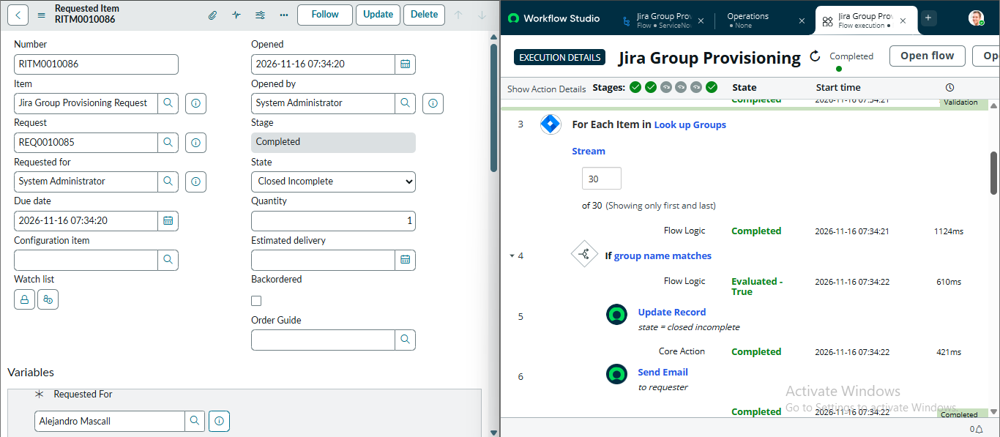
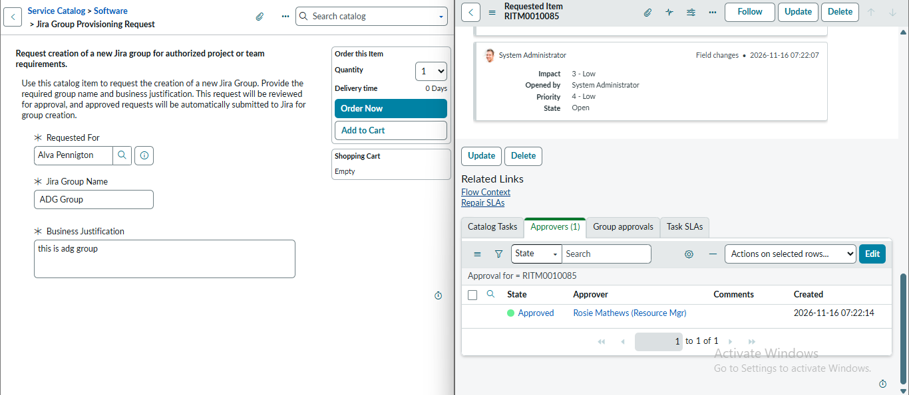
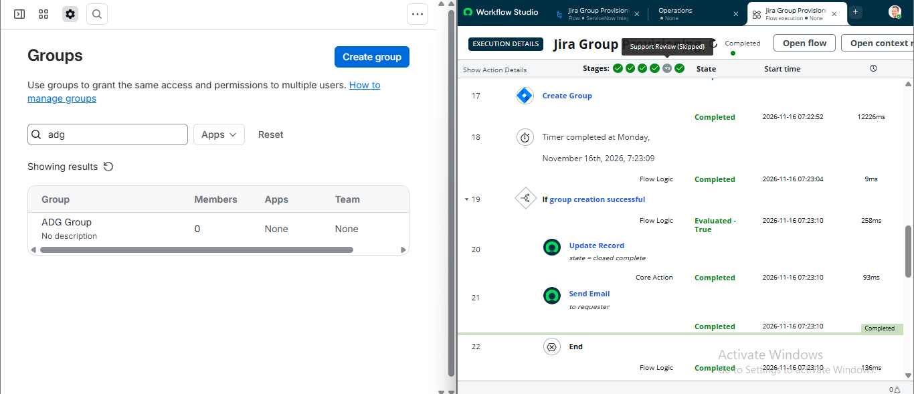
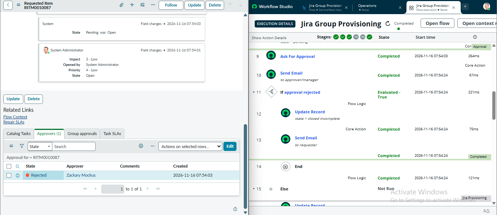
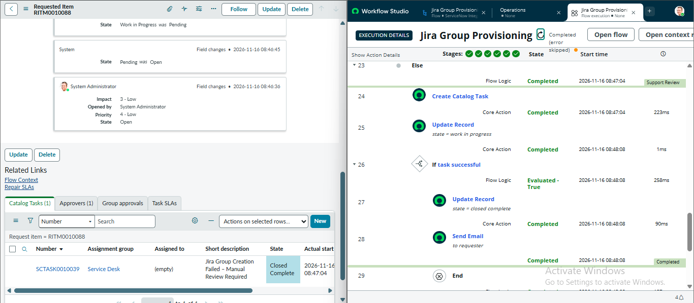
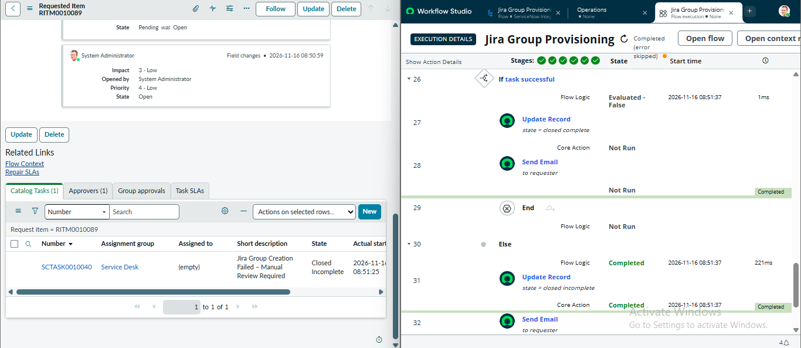
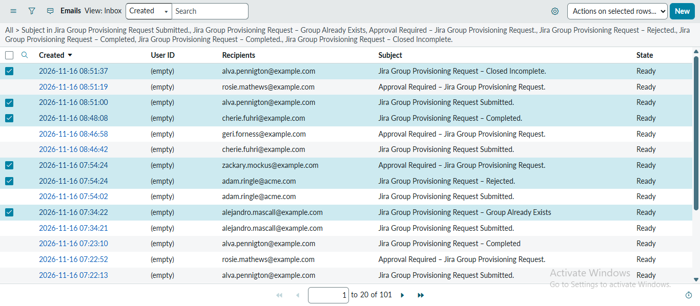

# Testing

This document describes the testing performed on the Jira Group Provisioning solution to validate the request lifecycle, group lookup, approval process, Jira group creation, and support intervention. It summarizes the scenarios tested and the resulting application behaviour. Selected screenshots are included to illustrate key workflow outcomes.

## Group Lookup & Validation

The existing group validation scenario was tested successfully. The flow identified the matching Jira group, moved the RITM to Closed Incomplete, skipped the approval and group creation steps, and sent the expected notification to the requester.

The multiple-group lookup scenario was tested successfully. The flow processed the collection and identified the requested group. The RITM was moved to Closed Incomplete, and the approval and group creation steps were skipped as expected.

## Approval & Jira Group Provisioning

The approval acceptance scenario was tested successfully. The Jira group was created, the RITM was moved to Closed Complete, and the requester received the expected notification.

The approval rejection scenario was also tested successfully. The RITM was moved to Closed Incomplete, the Jira group was not created, and the requester received the expected notification.

The Jira group creation failure scenario was tested successfully. The flow handled the creation failure as expected, kept the RITM in Work in Progress, entered the Support Review stage, and created a Catalog Task for manual support intervention.

## Support Intervention

Both support intervention outcomes were tested successfully. When the support task was completed successfully, the RITM was moved to Closed Complete. When the task was completed unsuccessfully, the RITM was moved to Closed Incomplete. The requester received the corresponding notification in both cases.

